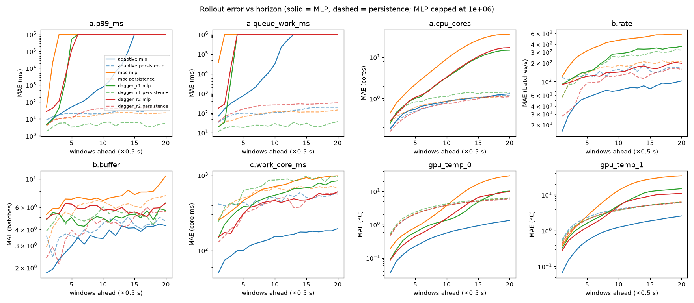
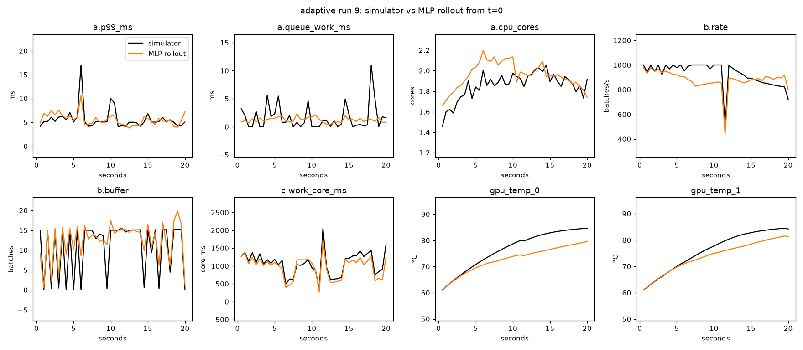
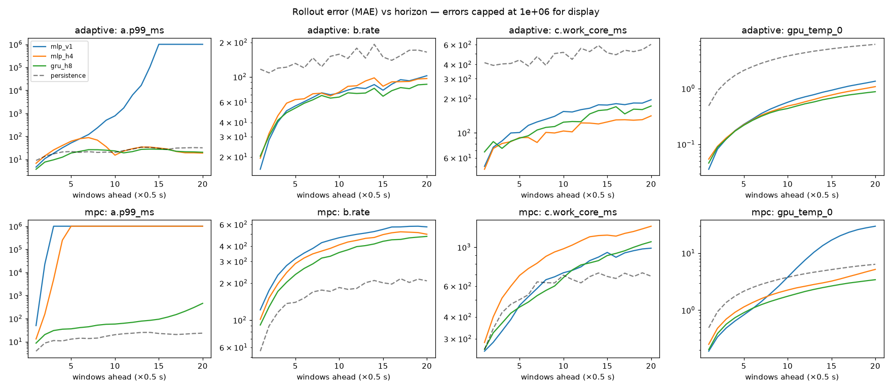
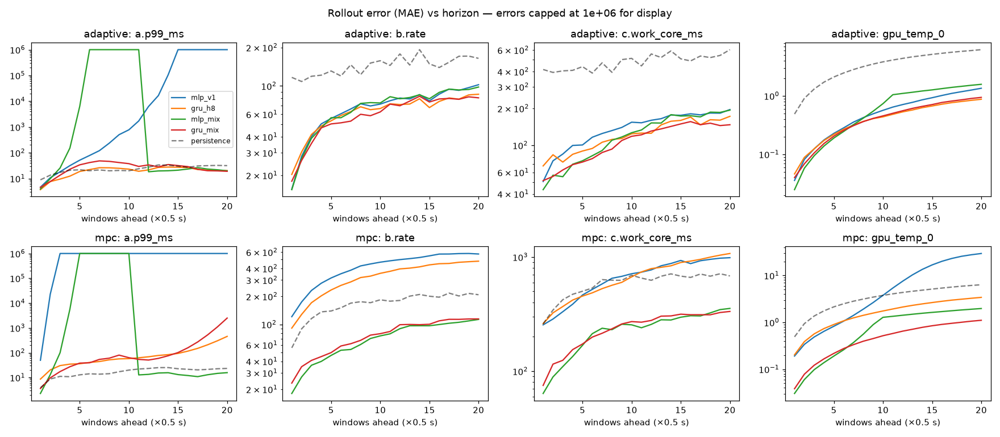

# Scheduler simulation model

Can a small neural network learn **how a system behaves** well enough to stand in for its simulator?

In an earlier project ([priority-scheduler](https://github.com/odedyohanan/priority-scheduler)) an ML model
learned to *make* scheduling decisions. Here the question is turned around: given the system's current state
and a scheduling decision, can a model **predict what happens next**? A model like this is called a
*world model*. This repository is a learning project, not a production system. v1 is a plain MLP, and
the code is set up so a GRU or a richer learned world model can slot in later.

## The system being modelled

A simulated machine with 8 CPUs (two cache domains) and 2 GPUs, shared by three workloads:

| Workload | What it models |
|---|---|
| **A** | A latency-critical request service with waves and bursts. Target: p99 latency ≤ 10 ms |
| **B** | GPU training: CPUs prepare batches into a buffer, GPUs consume them; GPUs heat up and throttle |
| **C** | Best-effort batch work that takes any spare CPU (and can use a GPU) |

Every 500 ms a controller picks a **policy**: which CPUs each workload may use, CPU weights, and who owns
each GPU. The simulator (copied from priority-scheduler into `sim/`) then runs that window in 1 ms steps,
with random arrivals, cache interference, migration costs and GPU thermals, and reports telemetry.

## What the model learns

```
 state at window t  ──┐
 (A latency/queue,    │
  B rate/buffer,      ├──►  MLP  ──►  change in state  ──►  state at window t+1
  C work, per-CPU     │      (2 × 128, ReLU)
  usage, GPU temps)   │
 applied policy  ─────┤
 known parameters ────┘
```

- **Inputs (75):** 39 state numbers from the window's telemetry, 33 numbers describing the applied
  policy, and 3 known parameters (A's service time, interference strength, room temperature).
- **Output (39):** the change in every state number. Predicting the *whole* state means the model can feed
  on its own predictions for multi-step rollouts.
- Heavy-tailed values (latency, queue) are log-compressed. Windows where no A request completed (p99
  reported as 0) are left out of the p99 loss.

## Data

- **Training:** 300 simulated minutes, 36k transitions in total (28.5k train, 3.6k validation, 3.6k test). The adaptive controller (a hand-written
  feedback rule) drives, and 30% of the windows apply a randomly perturbed policy instead, so the model
  also sees bad decisions. Whole runs are held out: run id ending in 8 → validation, in 9 → test.
- **Generalisation tests:** transitions recorded in the earlier project, from controllers the MLP never saw:
  the CP-SAT **MPC** teacher (5 950 test transitions) and the imitation **student** (DAgger rounds 1 and 2,
  1 190 each). Our simulator replays those runs bit for bit, so any difference is down to the
  controllers, not a changed simulator.

## Baselines and the noise floor

- **Persistence:** "the next window looks like this one".
- **Fluid model:** the hand-written physics model the MPC teacher used (RK4 fluid model + queueing theory),
  run for one window. It predicts only some of the targets.
- **Noise floor:** the simulator is random. Replaying a test run to a window and re-simulating that
  window 20 times with different seeds measures the randomness left *even when the simulator's full hidden
  state is known*. A model that sees only telemetry can't reach it, so it is a lower bound, not a target.

## Results (v1)

### One step ahead, same controller as training (adaptive test runs)

Absolute error in real units, **mean / median**. Lower is better. A mean far above the median means a few
large misses dominate.

| Target | MLP | Persistence | Fluid model | Noise floor |
|---|---|---|---|---|
| A p99 latency (ms) | **5.1** / **0.50** | 6.4 / 0.67 | 8.7 / 0.78 | 0.4 |
| A queued work (ms) | 74.5 / 1.23 | 31.7 / 1.65 | **21.8** / **1.22** | 1.2 |
| A CPU cores | **0.19** / 0.13 | 0.21 / **0.11** | — | 0.08 |
| B batches/s | **18.5** / 8.7 | 96.8 / **6.0** | 95.0 / 95.6 | 1.2 |
| B buffer (batches) | **1.7** / 0.84 | 3.0 / **0.38** | — | 0.2 |
| C work (core-ms) | 49.9 / 35.4 | 349 / 41.2 | **31.9** / **16.3** | 16.2 |
| GPU 0 temp (°C) | **0.04** / **0.02** | 0.31 / 0.15 | 0.21 / 0.14 | 0.0003 |

### One step ahead, controllers never seen in training

Median absolute error. The mean is dominated by a few wild misses: on MPC data, 5 of 5 950 predictions
produce 64% of the total queue error. Those states lie outside anything seen in training, and the MLP
predicts a queue of about 10⁷ ms where the truth is about 8 000.

| Target | MLP (MPC) | Persistence (MPC) | MLP (student r1) | Persistence (student r1) |
|---|---|---|---|---|
| A p99 latency (ms) | 2.25 | **0.52** | 1.54 | **0.36** |
| A queued work (ms) | 2.96 | **1.74** | 1.68 | **1.64** |
| B batches/s | 80.1 | **6.9** | 80.3 | **5.9** |
| C work (core-ms) | 197 | **46** | 156 | **28** |
| GPU 0 temp (°C) | **0.17** | 0.22 | **0.06** | 0.26 |

Full tables, with means, medians and overloaded states only (A queue > 100 ms):
[`results/onestep/report.md`](results/onestep/report.md).

### Many steps ahead (rollouts)

The MLP feeds on its own predictions for 20 windows (10 s), replaying the policies that were actually
applied.



A good stretch (adaptive test run 9): smooth quantities track the simulator for many seconds.



Tables and more examples: [`results/rollout/summary.md`](results/rollout/summary.md).

## What this shows

1. **On familiar states the MLP learns the big changes.** On GPU temperatures and A's latency it beats
   both baselines on both mean and median. On B's throughput and buffer it wins on the *mean* (B batches/s
   18.5 vs about 96) but loses on the *median* (8.7 vs 6.0 for "nothing changes"). It catches the rare
   large jumps, for example when a policy takes GPUs away from B, and it does that well. But in an
   ordinary calm window, "nothing changes" is the better guess.
2. **The physics model is hard to beat where the physics is simple.** For C's work and A's queue, the
   fluid model, with a few lines of equations and no training, wins.
3. **A's queue is the MLP's weak spot, even in-distribution.** A few overloaded states with huge queues
   dominate. A small error in log space becomes a very large error in milliseconds.
4. **It does not generalise to other controllers.** On states the MPC teacher or the student produced, the
   MLP is often worse than "nothing changes". The training data came from one controller (plus
   perturbations), and the MPC visits policy and state combinations the MLP never saw. This is the classic
   world-model lesson: **the model is only as good as the decisions in its data.**
5. **Rollouts explode.** Errors compound. On adaptive runs, GPU temperatures and B's rate stay better than
   persistence for the full 10 s. On the other controllers' runs even those drift past persistence
   after 5–7 s. Predicted latency and queue can grow without limit everywhere, because nothing stops the
   model predicting "the queue grows" again and again. Persistence is often the better 10-second forecast.
6. **The errors are well above the noise floor.** The floor is a lower bound: it assumes knowledge of
   hidden state, such as individual queued requests, that telemetry doesn't show. So not all of the gap
   can be closed from telemetry alone. But the gap is large, which points to a model that remembers
   recent windows, i.e. a GRU.

## Roadmap: fix the three weaknesses, one at a time

v1 has three problems: no memory, it knows only one controller, and its rollouts explode. Each step below
changes **one thing only**, so every result has a clear cause, and each step lives on its own branch.

1. **Memory:** MLP → GRU, nothing else changed. *Done, see below.*
2. **Varied data:** train on adaptive + MPC + student data. Does it generalise to other controllers? *Done, see below.*
3. **Bounded predictions:** keep rollouts physical. Do the explosions stop?

Later: an ensemble to tell when the model is uncertain, and a learned world model used for planning,
i.e. choosing policies by imagining their outcomes.

## Step 1: does memory help?

Two new models, with the same data, inputs, outputs, training and tests as v1:

| Model | What it sees |
|---|---|
| MLP v1 | the last window only |
| MLP with history (`mlp_h4`) | the last 4 windows, glued into one long input |
| GRU (`gru_h8`) | the last 8 windows, read one by one, with a memory |

The MLP with history checks whether simply *seeing more* is enough. If the GRU beats it, the way the GRU
uses memory matters.

### One step ahead (mean / median absolute error; bold = best median)

| Target | Test set | MLP v1 | MLP with history | GRU |
|---|---|---|---|---|
| A p99 latency (ms) | adaptive | 5.1 / **0.50** | 5.8 / 0.57 | 4.5 / 0.57 |
| B batches/s | adaptive | 18.5 / **8.7** | 23.0 / 12.9 | 22.6 / 11.9 |
| A queued work (ms) | MPC | 10 700 / 2.96 | 402 / 3.19 | 37 / **2.14** |
| A p99 latency (ms) | MPC | 38.8 / **2.25** | 14.9 / 3.21 | 9.1 / 2.39 |
| A CPU cores | MPC | 0.48 / 0.35 | 0.54 / 0.41 | 0.30 / **0.23** |
| B buffer (batches) | MPC | 5.4 / 4.1 | 5.6 / 4.6 | 4.4 / **3.6** |

Best median, out of 8 targets: on adaptive data, MLP v1 5, GRU 2, MLP with history 1. On MPC data,
GRU 6, MLP v1 2, MLP with history 0.

### Many steps ahead: A p99 latency error after 10 s (20 windows)

| Test set | MLP v1 | MLP with history | GRU | Persistence |
|---|---|---|---|---|
| adaptive | 1.7 × 10¹⁸ | **18.7** | 20.3 | 31.6 |
| MPC | 1.9 × 10²⁹⁰ | 1.0 × 10³² | **456** | 23.3 |
| student r1 | 4.6 × 10²³⁴ | 4.3 × 10²² | **27.4** | 5.6 |



All tables: [`results/compare_step1/report.md`](results/compare_step1/report.md).

### What step 1 shows

1. **On familiar data, memory doesn't help the typical prediction.** On the adaptive test runs, MLP v1
   has the best median error on 5 of 8 targets.
2. **On the MPC controller's data, the GRU is best.** It has the best median on 6 of 8 targets there. It
   also makes far fewer wild mistakes: A's queue error falls from 10 700 ms (mean) to 37 ms. On the
   student's data the picture is mixed, and no model wins clearly.
3. **The history models overfit.** Both have a worse validation loss than v1 (0.195 and 0.202, against
   0.173). During training they reach a *lower* training loss than v1 ever does (0.157 and 0.143, against
   0.161), and their gap between training and validation loss is about 2.5× larger. With more input, they
   start memorising details of the 240 training runs instead of general rules.
4. **The GRU's rollouts diverge far more slowly, but they still diverge.** After 10 s, MLP v1's latency
   predictions reach 10²⁹⁰. The GRU's error on MPC data grows 8.6 → 36 → 58 → 456 ms. That's far saner, but
   still about 20× worse than "nothing changes" (23 ms), and its queue error reaches 5 260 ms against 145.
   The MLP with history explodes too, but only on other controllers' data. On familiar data it is fine.
   So *seeing more* isn't what slows the GRU down. The reason is mostly mechanical: the GRU's memory is
   squashed into the range −1…1 (tanh) and fed to a linear output layer, so the change it can predict in
   one step has a hard limit. That is a property of the architecture, not proof that it "understands" the
   system.
5. **Other controllers are still the main problem.** On MPC and student runs, "nothing changes" still
   beats every model on latency and B's throughput most of the time. Step 1 didn't fix the data problem;
   that's step 2's job.
6. **Over 10 s on familiar data, the GRU is best on GPU temperature and B's throughput.**

**Caveat:** every model was trained once, with one random seed and v1's training settings (learning rate,
early stopping). Small differences, such as validation losses 0.02 apart or close medians, may be within
seed-to-seed variation. Running several seeds would settle that.

## Step 2: does varied data help?

Same two model types as before (MLP v1's settings, and the GRU with 8 windows), same features, training
settings and tests. Only the **training data** changes:

| Data set | Used for training? | Training windows |
|---|---|---|
| adaptive (our controller) | yes | 28.6k |
| MPC (`teacher_v2`) | yes | 47.6k |
| student round 1 (`dagger_r1`) | yes | 9.5k |
| student round 2 (`dagger_r2`) | **no, kept completely unseen** | 0 |

Student r2 is held back on purpose, so we can still test a controller the model has *never met*. As
always, the test runs (run id ending in 9) of every set are never used for training. The sets are mixed
as they are, with no re-weighting, so MPC is about 55% of the training data.

One fix was needed first. The adaptive and MPC data reuse the same run numbers (0–299), and the code
looked up runs by number alone. For a history model, that would glue two different runs into one fake
history. Runs are now identified by (data set, run number). Step 1's results are unchanged by this fix.

### One step ahead (mean / median absolute error; bold = best median)

| Target | Test set | MLP v1 | GRU (step 1) | MLP, mixed data | GRU, mixed data |
|---|---|---|---|---|---|
| A p99 latency (ms) | adaptive | 5.1 / 0.50 | 4.5 / 0.57 | 4.3 / **0.44** | 5.4 / 0.51 |
| A p99 latency (ms) | MPC | 38.8 / 2.25 | 9.1 / 2.39 | 3.6 / **0.46** | 4.9 / 0.59 |
| B batches/s | MPC | 107 / 80.1 | 88.3 / 75.0 | 19.1 / **11.4** | 24.5 / 15.5 |
| C work (core-ms) | MPC | 252 / 197 | 260 / 195 | 67.8 / **49.1** | 84.2 / 60.9 |
| A p99 latency (ms) | student r2 (unseen) | 21.6 / 1.23 | 14.8 / 2.40 | 2.2 / **0.36** | 8.6 / 0.36 |
| B batches/s | student r2 (unseen) | 64.5 / 50.1 | 91.0 / 70.7 | 16.5 / **9.7** | 19.1 / 12.2 |
| C work (core-ms) | student r2 (unseen) | 148 / 88.3 | 168 / 132 | 55.0 / **38.1** | 60.6 / 43.5 |

Best median, out of 8 targets, for the MLP with mixed data: 6 on adaptive, 7 on MPC, 5 on student r1 and
6 on student r2. The GRU with mixed data wins all the others except one: on adaptive data, MLP v1 still
has the best median for B's throughput. (On student r2, the two mixed models' latency medians are tied at
0.36 ms.)

### Many steps ahead: error after 10 s (20 windows) on student r2, the unseen controller

| Target | MLP v1 | GRU (step 1) | MLP, mixed data | GRU, mixed data | Persistence |
|---|---|---|---|---|---|
| A p99 latency (ms) | 4.4 × 10³⁰¹ | 36.4 | 35.3 * | **34.0** | 50.7 |
| B batches/s | 198 | 306 | **79.7** | 111 | 158 |
| C work (core-ms) | 604 | 489 | **358** | 393 | 563 |
| GPU 0 temperature (°C) | 9.8 | 2.1 | 2.3 | **0.89** | 5.9 |

\* Misleading on its own: about 2% of this model's rollouts blow up to infinity, and those are left out
of the average. At 2.5 and 5 s, while they're still finite, they push the mean to 10⁴–10¹³³ ms.



All tables: [`results/compare_step2/report.md`](results/compare_step2/report.md).

### What step 2 shows

1. **Varied data fixes most of the generalisation problem.** On MPC data, the typical (median) error
   drops by 2–8× for every target compared with MLP v1. For example, B's throughput error falls from 80
   to 11 batches/s. One step ahead, the mixed-data MLP's *mean* error now beats "nothing changes"
   on other controllers' data for all four plotted targets. On *medians*, "nothing changes" still wins
   for B's throughput and C's work, so typical windows where little changes are still slightly hard.
2. **It also works on the controller the model never saw.** On student r2, the mixed-data MLP's median
   latency error is 0.36 ms (MLP v1: 1.23 ms), and B's throughput error is 9.7 (v1: 50.1). So the model
   didn't just memorise three controllers. Seeing a *range* of behaviour helped it with a new one.
3. **One step ahead, almost nothing was lost on familiar data.** On the adaptive test runs, the mixed-data MLP has a
   better median than MLP v1 on 6 of 8 targets and is slightly worse on two (B's throughput: 9.3 against
   8.7; A's queue: 1.25 against 1.23 ms). Its rollouts on adaptive data are a different story (point 5).
4. **With varied data, the plain MLP beats the GRU again.** It wins most targets and has a lower
   validation loss (0.184 against 0.211). One possible reading: in step 1, memory partly made up for
   unfamiliar data, and varied data does that job better. Overfitting may play a part too: the mixed
   GRU's best validation loss came at about epoch 46, while the MLP kept improving until about epoch 185.
5. **Rollouts: the mixed-data MLP still explodes.** On MPC and student r2 data, about 1–2% of its latency
   rollouts blow up, and those few still dominate the averages. On adaptive data it is now *worse* than
   MLP v1 (latency error after 5 s: 6 290 ms, against 52), and other targets explode too, such as A's
   queued work. None of the mixed-data GRU's rollouts on MPC or student r2 data went above 10⁶. Over 10 s
   on the unseen controller, it beats "nothing changes" on all four plotted targets. But it can still
   drift a long way: on MPC data its latency error after 10 s is 2 490 ms, against 23 for "nothing
   changes". Keeping every rollout physical is step 3's job.

**Caveat:** one random seed per model, as in step 1. The step-2 improvements are large (several times),
so they are very unlikely to be seed noise. Close calls between the two mixed-data models might be.

## How to run

Python 3 with numpy, torch, matplotlib, pytest. The generalisation test sets come from a checkout of the
earlier project's data in a sibling directory, `../priority_scheduler_model/data`. You can set `OLD_DATA`
to point elsewhere.

```bash
python3 -m venv .venv && .venv/bin/pip install -r requirements.txt
.venv/bin/pytest -q
```

```bash
# 1. data: 300 one-minute runs (~3 min at full speed; scripts/gentle.sh runs it at low priority, ~1 h)
.venv/bin/python experiments/generate_data.py --runs 300 --procs 5 --out data/adaptive_v1
# 2. train (a few minutes on CPU)
.venv/bin/python experiments/train.py --data data/adaptive_v1 --out models/mlp_v1.pt
# 3. one-step evaluation against baselines and the noise floor (~3 min)
.venv/bin/python experiments/evaluate.py --model models/mlp_v1.pt --out results/onestep
# 4. multi-step rollouts and plots
.venv/bin/python experiments/rollout.py --model models/mlp_v1.pt --out results/rollout
```

Step 1 models (each a few minutes on CPU), then the comparison:

```bash
.venv/bin/python experiments/train.py --data data/adaptive_v1 --arch mlp --history 4 --out models/mlp_h4.pt
.venv/bin/python experiments/train.py --data data/adaptive_v1 --arch gru --history 8 --out models/gru_h8.pt
# for each model: evaluate.py --noise-runs 0 --out results/onestep_<name>, rollout.py --out results/rollout_<name>
.venv/bin/python experiments/compare.py --out results/compare_step1 --models \
  mlp_v1:results/onestep:results/rollout,mlp_h4:results/onestep_mlp_h4:results/rollout_mlp_h4,gru_h8:results/onestep_gru_h8:results/rollout_gru_h8
```

Step 2 models: the same commands, with three data directories (`$OLD` is `../priority_scheduler_model/data`):

```bash
.venv/bin/python experiments/train.py --data data/adaptive_v1,$OLD/teacher_v2,$OLD/dagger_r1 --arch mlp --history 1 --out models/mlp_mix.pt
.venv/bin/python experiments/train.py --data data/adaptive_v1,$OLD/teacher_v2,$OLD/dagger_r1 --arch gru --history 8 --out models/gru_mix.pt
.venv/bin/python experiments/compare.py --out results/compare_step2 --models \
  mlp_v1:results/onestep:results/rollout,gru_h8:results/onestep_gru_h8:results/rollout_gru_h8,mlp_mix:results/onestep_mlp_mix:results/rollout_mlp_mix,gru_mix:results/onestep_gru_mix:results/rollout_gru_mix
```

## Layout

```
sim/            the simulator and adaptive controller, copied from priority-scheduler (no CP-SAT)
worldmodel/     generate.py, data.py, features.py, history.py, model.py (MLP, GRU), train.py,
                baselines.py, metrics.py, noise.py, rollout.py
experiments/    command-line scripts for each step above
scripts/        gentle.sh (run a long job at low priority on macOS), stop.sh
results/        reports and plots
tests/          pytest suite
```
